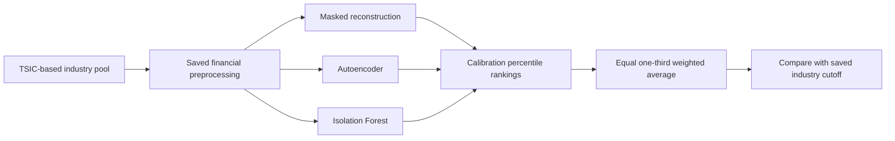

# Transfer Pricing Preliminary Risk Indicator

A **local standalone tool** for reviewers who want to understand which financial patterns and company-specific facts may need closer transfer-pricing review. It provides financial signals and an explainable checklist. It does not decide whether a company has broken tax rules.

[**Download the Windows reviewer**](https://github.com/Witchayada-T/Transfer-pricing-preliminary-risk-indicator/releases/download/reviewer-latest/Transfer-Pricing-Reviewer-Windows.zip) · [**Read the screening logic**](docs/SCREENING_LOGIC.md) · [How to run](#run-locally) · [Source code](application/app.py)

## Run locally

**Windows, no Python required:** download the reviewer ZIP, extract all files, and double-click `ThaiCompanyReview.exe`. Keep `_internal` beside the EXE. The controller opens the app in a local browser; close the controller to stop it.

The download is built and checked by [GitHub Actions](https://github.com/Witchayada-T/Transfer-pricing-preliminary-risk-indicator/actions/workflows/build-reviewer.yml). If a build is still running, wait for the Windows release to finish. This is an unsigned research prototype, not a certified tax product.

**Python alternative:** use Python **3.12**. From a local checkout of this repository:

```bash
python -m pip install -r requirements.txt
python -m streamlit run application/app.py --server.address 127.0.0.1
```

Use a dedicated virtual environment if one is available. No AWS account or online application deployment is required.

## What a reviewer can do

1. Enter a new company, its TSIC/business activity and a primary functional profile: Risk-taking, Routine or Market-facing entity.
2. Optionally compare its financial information with the saved industry models.
3. Answer Yes / No / Unknown risk questions and record commercial context.
4. Read the financial result and the independent rule-based result separately, then download a review record if needed.

This public reviewer edition **does not include the collected-company financial table, historical-company examples, source evidence archives or the private research report**. It includes the frozen model parameters, financial-field dictionary, industry-scope metadata and the code needed to inspect the logic. A trained model is shared; no claim of formal model-privacy protection is made.

## How the financial result is produced



The final score uses **three methods**. K-means was preliminary exploration and is not a fourth financial score. The score is a relative financial-pattern ranking, **not a probability of a transfer-pricing error**. Unsupported industry codes, years or inadequate financial inputs receive Not assessed.

The model scope is six broad Thai business pools and FY2021–FY2025: electronics manufacturing, electronics trading, printing, IT services, accounting/back-office support and transport/logistics. A broad industry match does not establish transaction-level comparability.

## The independent checklist

| Result | Meaning |
|---|---|
| Higher concern | At least one applicable risk indicator is Yes. Notes are optional. |
| Less concern | All applicable risk indicators are No and required profile, transaction and functional context is complete. |
| More information needed | No risk Yes exists but required facts remain incomplete. |

Selecting a profile or confirming that a function is performed is not itself a risk trigger. Financial flags cannot cancel a reported checklist concern. The one-Yes rule is a **conservative review-priority policy**, not an official HMRC risk classification.

A flagged financial pattern may have a documented commercial explanation. The tool retains the original signal so that a reviewer can examine and explain it rather than treating a flag as a final verdict. HMRC explicitly cautions that a single indicator does not automatically mean high transfer-pricing risk.

## Confidentiality and sharing

The intended use is local review. New financial figures and review notes are processed by the local application; they are not automatically uploaded to GitHub or a shared model service. Review exports are ordinary local files and must be handled appropriately by their recipient. Do not commit confidential company inputs to this public repository.

## Read or inspect the logic

- [Plain-English screening logic](docs/SCREENING_LOGIC.md)
- [Model scoring and cutoff code](model_engine.py)
- [Financial features and prior-year calculations](financial_criteria.py)
- [Additional financial review indicators](financial_decision_rules.py)
- [Independent functional-profile rules](application/review_rules.py)
- [Preprocessing pipelines](sklearn_pipelines.py)
- [Verification](verification/README.md)

Background: [HMRC risk indicators](https://www.gov.uk/hmrc-internal-manuals/international-manual/intm482040) · [company/group and functional context](https://www.gov.uk/hmrc-internal-manuals/international-manual/intm482070) · [persistent losses](https://www.gov.uk/hmrc-internal-manuals/international-manual/intm482080). UK guidance supplies review topics; the prototype does not apply UK law in place of Thai law.
